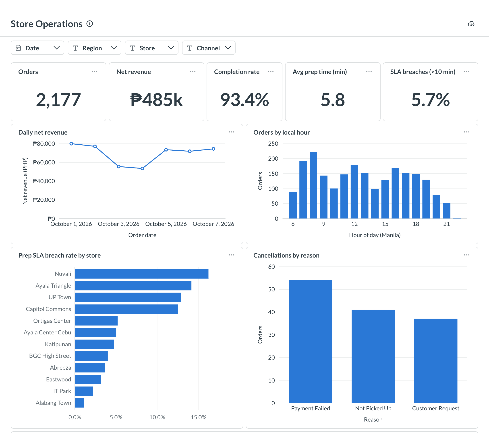
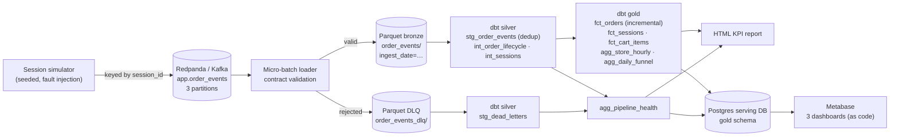
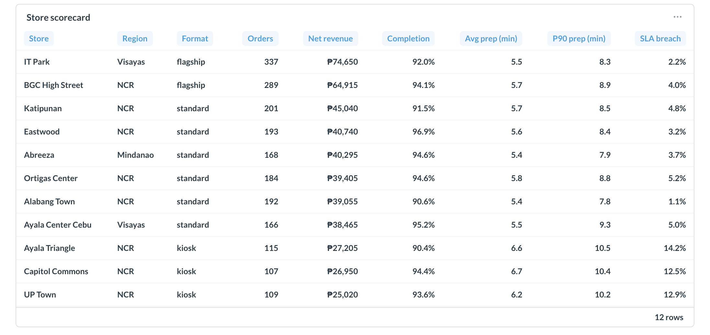
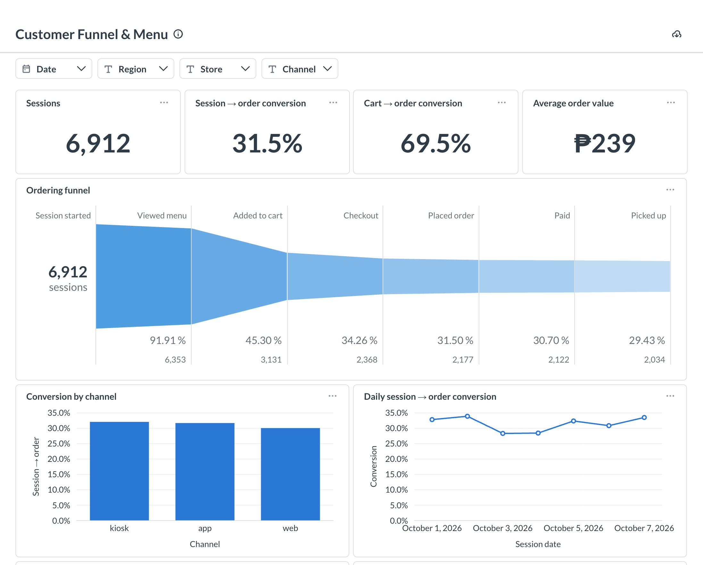
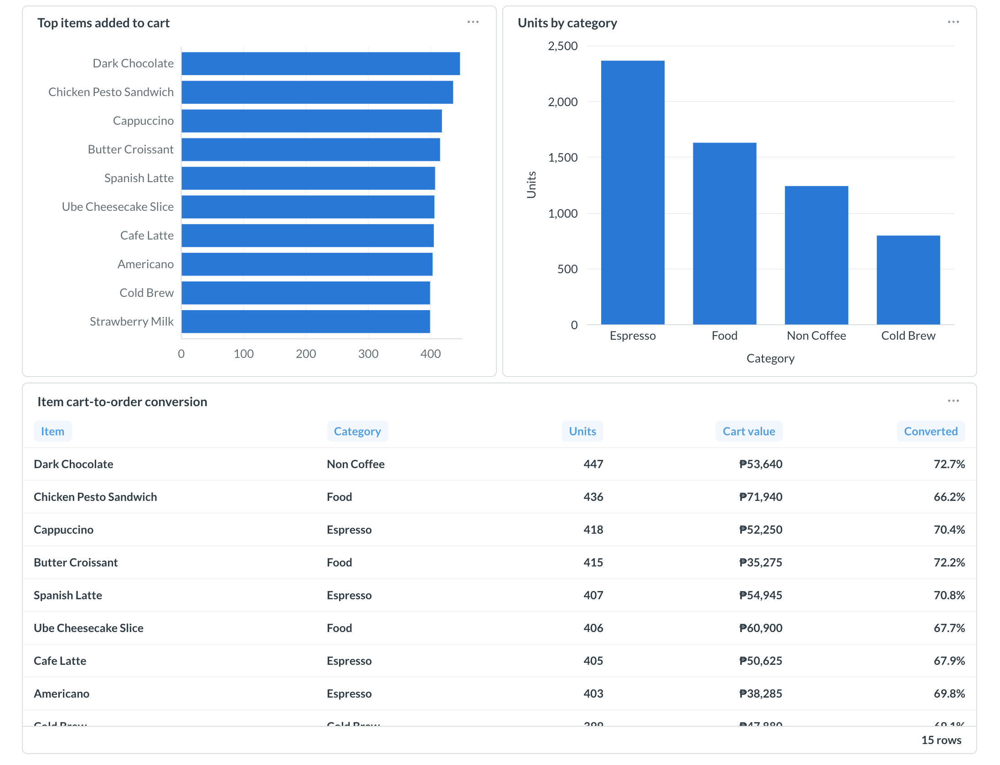
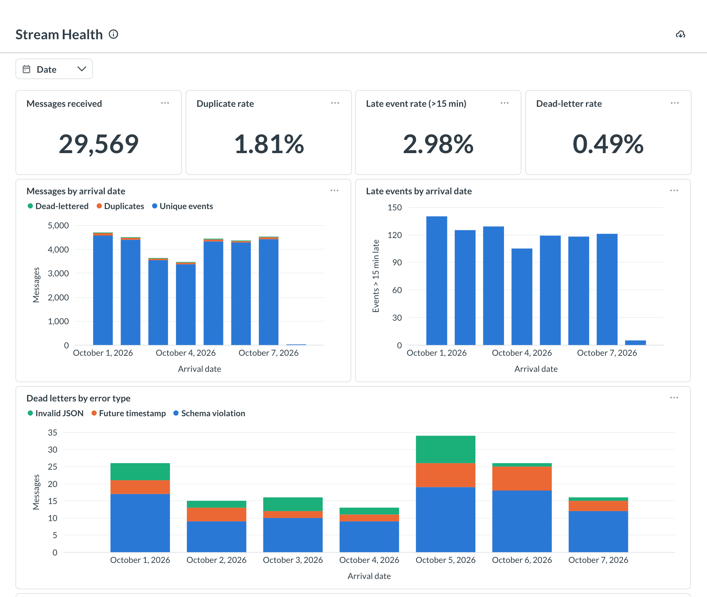
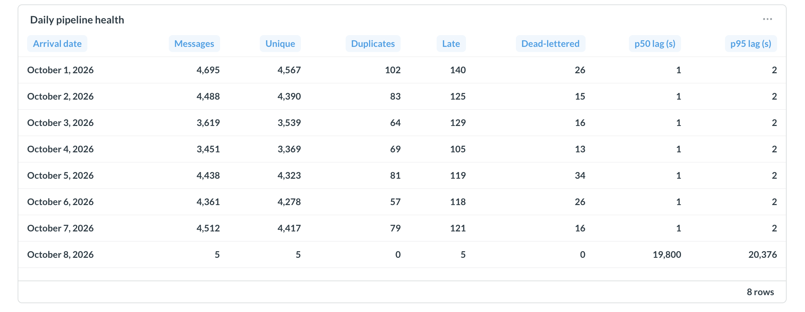
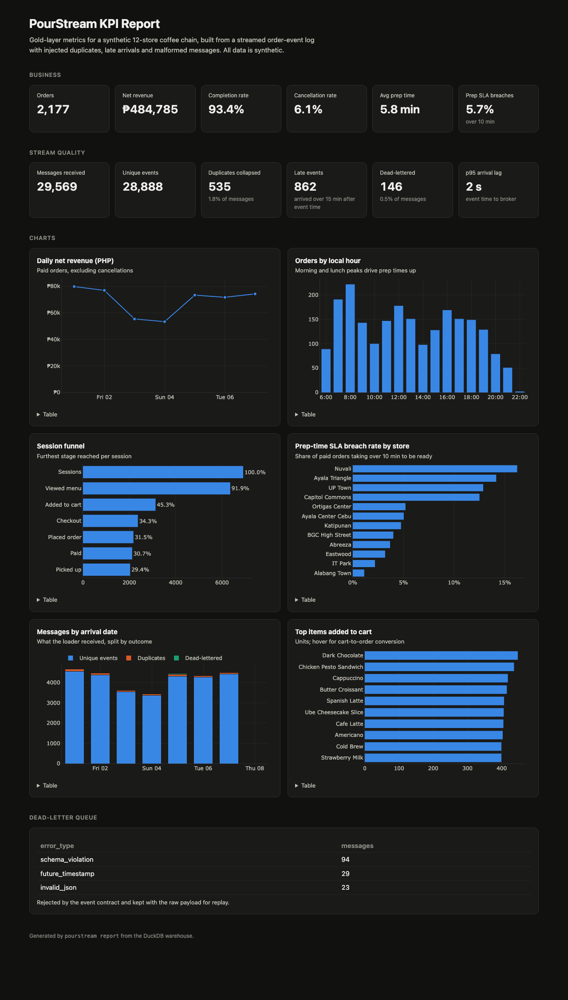

# PourStream: Streaming Order-Event Pipeline

[](https://github.com/almontemike2001-star/pourstream-event-pipeline/actions/workflows/ci.yml)

A streaming data pipeline for a synthetic 12-store coffee chain. Mobile, web and kiosk ordering
events go through Kafka (Redpanda). A Python micro-batch loader validates them against a data
contract and writes them to a Parquet lake. dbt then builds silver and gold models in DuckDB
that handle duplicates, late arrivals and malformed messages correctly. The gold marts are
published to a Postgres serving layer and explored in three **Metabase dashboards built as code**.

**[View the live KPI report →](https://almontemike2001-star.github.io/pourstream-event-pipeline/kpi_report.html)**

All data is synthetic. It is generated by a seeded simulator in this repo.



---

## Why this project

My first portfolio project, [BeanFlow](https://github.com/almontemike2001-star/retail-analytics-platform),
is a **batch** platform: PostgreSQL → BigQuery → dbt. PourStream covers the other half of data
engineering work: **event streams**. Event streams bring problems that batch extracts mostly
don't have:

| Stream problem | How PourStream handles it |
|---|---|
| Client retries and loader replays deliver the same event twice | At-least-once loading, then deduplication on `event_id` in silver |
| Phones buffer events offline and send them hours later | Late-data-aware incremental model that rebuilds affected orders |
| Events arrive out of order | Lifecycle state comes from event time, never arrival order |
| Broken clients send bad payloads | Pydantic data contract plus a dead-letter queue that keeps the raw payload |
| Device clocks drift into the future | Rejected as `future_timestamp` (max skew 5 min vs. broker time) |
| A crash between "write" and "commit" | Offsets are committed only after the lake write. A replay is harmless |

## Architecture



| Layer | Tech | Notes |
|---|---|---|
| Broker | Redpanda (Kafka API) in Docker | A file-backed broker with the same semantics runs offline and in CI |
| Ingestion | Python 3.12, confluent-kafka, Pydantic v2, PyArrow | Idempotent producer, manual offset commits, atomic Parquet writes |
| Lake | Parquet + zstd, Hive-partitioned by ingest date | Append-only. One file per micro-batch |
| Transform | dbt-core 1.12 + dbt-duckdb | Silver views, gold tables, incremental `delete+insert` |
| Serving | PostgreSQL 16, loaded through DuckDB's postgres extension | BI reads a copy, so dashboards never lock the warehouse |
| BI | Metabase v0.63 | 3 dashboards, 28 questions, 4 linked filters, all created through the Metabase API |
| Quality | 35 dbt data tests, 30 pytest tests, ruff | Includes reconciliation and lifecycle-ordering checks |
| CI | GitHub Actions | Lint → tests against a real Redpanda → full pipeline → report artifact |

## Quickstart

Requires [uv](https://docs.astral.sh/uv/). Docker is optional.

```bash
make setup        # create .venv with Python 3.12 and install dependencies
make run          # simulate → file broker → load → dbt build → reports/kpi_report.html
```

Through a real Kafka broker:

```bash
make run-kafka    # docker compose up Redpanda, then the same pipeline over Kafka
                  # Redpanda Console: http://localhost:8080
```

Metabase dashboards (needs Docker):

```bash
make bi-up        # Postgres serving DB (localhost:5434) + Metabase (http://localhost:3001)
make publish      # copy gold marts from DuckDB to Postgres
make dashboards   # create the connection, questions, filters and dashboards via the API
make screenshots  # optional: regenerate docs/images from the public dashboard links
```

Individual steps: `pourstream [--transport kafka|file] produce | load | transform [dbt args] | report | publish`.
Simulation size: `pourstream run --days 14 --sessions 120 --seed 7`.

## The data contract

Every message must parse into [`OrderEvent`](src/pourstream/events.py):

- Fields are strictly typed and unknown fields are rejected (`extra="forbid"`). `event_ts` must be timezone-aware and is normalized to UTC.
- Some fields are required per event type. For example, `order_placed` needs `order_id` and `amount`, `item_added` needs `item_sku` and `quantity`, and payment events need `payment_method`.
- `store_id` must match `ST###`, and quantities and amounts are range-checked.

Rejected messages go to `order_events_dlq` with an `error_type` (`invalid_json`, `schema_violation`
or `future_timestamp`), a readable `error_detail`, the raw payload, and the Kafka coordinates.
They can be fixed and replayed later.

## Delivery semantics

The loader is **at-least-once by design**:

1. Poll up to N messages.
2. Validate, then write bronze and DLQ Parquet files atomically (temp file + rename).
3. Commit offsets (`enable.auto.commit = false`).

If the process dies between steps 2 and 3, the batch is re-read and written again.
`stg_order_events` keeps the first delivery of each `event_id`. The same step collapses
duplicates the producer itself sent, so exactly-once *results* do not depend on
exactly-once *delivery*. `test_replay_after_crash_duplicates_bronze_but_not_events` covers this.

## Late data and the incremental fact

`fct_orders` is incremental (`delete+insert` on `order_id`). On each run it:

1. finds every order that received any event ingested since the last run (minus a configurable lookback),
2. rebuilds those orders from **all** of their events, not just the new ones.

So a `payment_succeeded` event that arrives six hours late updates the existing order row instead
of being dropped or creating a second row.
`test_incremental_run_with_late_events_matches_full_refresh` loads the stream in two halves with
the lookback set to zero. It asserts that the incremental table equals a full rebuild. A naive
"append new orders only" strategy fails this test (verified by mutation).

## Models

| Model | Grain | What it's for |
|---|---|---|
| `silver.stg_order_events` | event | Deduped events with `arrival_lag_seconds`, `is_late`, `delivery_count` |
| `silver.stg_dead_letters` | rejected message | DLQ analysis and replay |
| `silver.int_order_lifecycle` | order | Lifecycle timestamps pivoted from events |
| `silver.int_sessions` | session | Furthest funnel stage reached |
| `gold.fct_orders` | order | Status, revenue, prep time, SLA flag (incremental) |
| `gold.fct_sessions` | session | Funnel flags joined to order outcome |
| `gold.fct_cart_items` | cart line | Item demand and cart-to-order conversion |
| `gold.agg_store_hourly` | store × local hour | Orders, revenue, avg/p90 prep time, SLA breach rate |
| `gold.agg_daily_funnel` | local date × channel | Session → menu → cart → checkout → order → paid → pickup |
| `gold.agg_pipeline_health` | arrival date | Duplicates, late events, DLQ rate, arrival-lag p50/p95 |

A **later funnel stage implies the earlier ones**. When a `menu_viewed` or `payment_succeeded`
event is dead-lettered, the session still counts as having reached that stage. The dbt test
`assert_funnel_is_monotonic` caught this edge case during development.

## Metabase dashboards

The dashboards are built by [`bi/metabase/build_dashboards.py`](bi/metabase/build_dashboards.py),
not by clicking. The script completes Metabase's first-run setup, registers the serving database,
and creates every native-SQL question with **field filters**. It wires the dashboard filters
(Date, Region, Store, Channel) to each question and enables public links. Re-running it archives
the old versions and rebuilds them, so the dashboards are reviewable in git like the dbt models.

### Store Operations
Orders, net revenue, completion rate, prep time and the 10-minute prep SLA. The four kiosk-format
stores breach the SLA about 4× as often as the rest (14.0% vs 3.5% of paid orders), and kiosk
breaches cluster at the lunch (12–1 pm) and 7–8 am peaks, where up to 42% of orders miss it.




### Customer Funnel & Menu
Session → menu → cart → checkout → order → paid → pickup, conversion by channel, and item
demand with cart-to-order conversion.




### Stream Health
The data-engineering view: messages by outcome, duplicate, late and dead-letter rates, dead letters
by error type, and daily arrival lag.




The static [HTML KPI report](https://almontemike2001-star.github.io/pourstream-event-pipeline/kpi_report.html)
(`pourstream report`) shows the same headline numbers without needing Docker:



## Testing

```bash
make test         # everything; Kafka tests auto-skip when no broker is reachable
make test-fast    # unit tests only
```

- **Contract**: each violation type is classified correctly. Small clock skew is tolerated.
- **Simulator**: deterministic per seed. Fault rates match config. *Exactly* the malformed messages fail the contract.
- **Transport**: keyed partitioning, per-key ordering, resume from committed offsets, redelivery after a crash, independent consumer groups.
- **Loader**: bronze/DLQ split, empty-lake readability, a full drain accounts for every message, replay safety.
- **End-to-end**: pipeline-health totals reconcile exactly with the simulator's ground truth. Incremental equals full refresh.
- **Kafka integration**: round trip through Redpanda. A second consumer reads nothing (offsets committed).
- **Serving layer**: every gold table lands in Postgres with identical row counts (runs when the BI stack is up).
- **dbt**: uniqueness and not-null, accepted values, relationships to seeds, lifecycle ordering, no revenue on unpaid or cancelled orders, hourly revenue reconciles to the order fact.

## Sample run (default seed)

| Metric | Value |
|---|---|
| Messages received | 29,569 |
| Unique events | 28,888 |
| Duplicates collapsed | 535 (1.8%) |
| Late events (> 15 min) | 862 |
| Dead-lettered | 146 (94 schema, 29 future timestamp, 23 invalid JSON) |
| Orders / completion rate | 2,177 / 93.4% |
| Net revenue | ₱484,785 |
| Prep-time SLA breaches (> 10 min) | 5.7%, mostly kiosk-format stores at peak hours |

## Project layout

```text
src/pourstream/
  events.py         data contract + parse_event()
  generator.py      seeded session simulator with fault injection
  transport.py      Kafka + file-broker producers/consumers
  loader.py         micro-batch loader, Parquet lake writer
  pipeline.py       produce / load / transform steps
  report.py         HTML KPI report from gold
  serving.py        publish gold marts to the Postgres serving DB
  cli.py            `pourstream` command
dbt/
  models/staging      stg_order_events, stg_dead_letters
  models/intermediate int_order_lifecycle, int_sessions
  models/marts        facts, aggregates, pipeline health
  seeds/              stores, menu_items (shared with the simulator)
  tests/              singular data tests
bi/metabase/
  docker-compose.yml  Postgres serving DB + Metabase (+ its app DB)
  build_dashboards.py dashboards as code (Metabase API)
  screenshot.mjs      captures the public dashboards into docs/images
tests/              pytest suite
docker-compose.yml  Redpanda + Console
```

## Trade-offs and next steps

- **Micro-batch, not per-event streaming.** Seconds of latency are fine for these KPIs, and a micro-batch write produces healthy Parquet file sizes. Sub-second needs would call for a stream processor such as Flink or a streaming database.
- **DuckDB as the warehouse** keeps the project free and runnable anywhere. The same dbt models port to BigQuery, Snowflake or ClickHouse with small dialect changes.
- **The schema is enforced in the consumer, not a registry.** The next step is Avro or Protobuf with a schema registry (Redpanda ships one) and compatibility checks in CI.
- **Next:** small-file compaction for bronze, orchestration (Dagster or Airflow sensors on new batches), and DLQ replay tooling.
